# 操作と画面の配置（IMPROVE_controls、10/31 の夜）

## まとめ

- 仕様書 `IMPROVE_controls.md` の **段1〜5を全部作った。**
- ルールのテストの出力は、作る前と **1文字も変わらない**（前からある失敗はそのまま）。
- **コミットはしていない**（ブランチ `lab-n`。変えたファイルは下）。
- **最新版を Cloudflare に公開した**（10/31 10:01、publish `b845bdb`。オーナーの依頼）。https://caffilia-jkwzvlbc7.kate108superstar.workers.dev/latest/
- 写真は 1280×800 で撮った（このフォルダの `操作と配置_20261031/`）。

```
┌ 上のバー ─────────────────────── [1手戻す][遊び方] ┐  ← 「発動」はなくした
│ 目標 / お題・勝ち / ターン2/5        ┌ 右上：見るところ ─────┐
│ （ヒントの1行）                      │ 味方 (山)(水)          │
│ [絵]空き       │ 案内の1行           │ 発動の順番 ▲▼          │
│ [駒]味方「水」 │                     │ 敵                     │
│ ┌ 盤面 ──────────┐               ├ 右下：さわるところ ───┤
│ │                    │               │    ↑                  │
│ │                    │               │ ← 向き →  [ 魔法 ]    │
│ │                    │               │    ↓      [ 待機 ]    │
│ └──────────┘               │ [ 発動／クリアする／次へ／やり直す ] │
└──────────────────────────────────────┘
```

---

## 写真

| | |
|---|---|
| 遊び方（7行） | 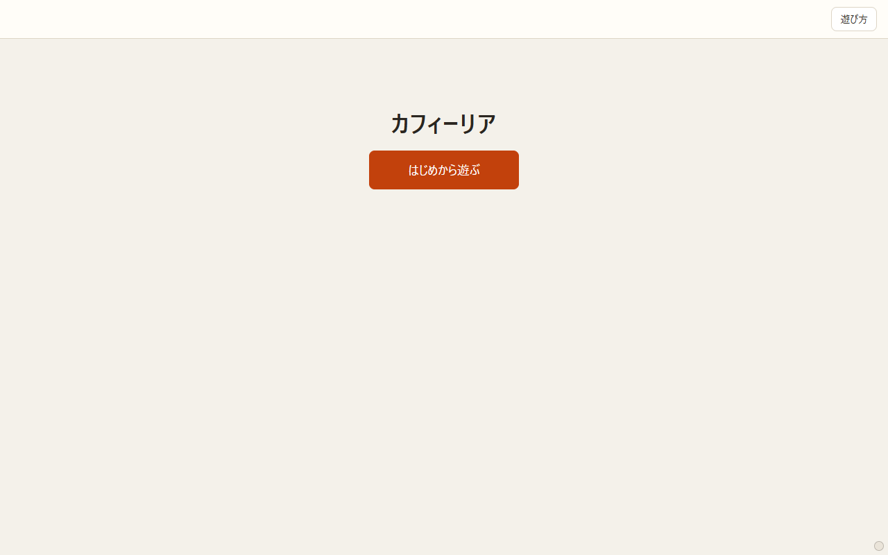 |
| ① 始め | 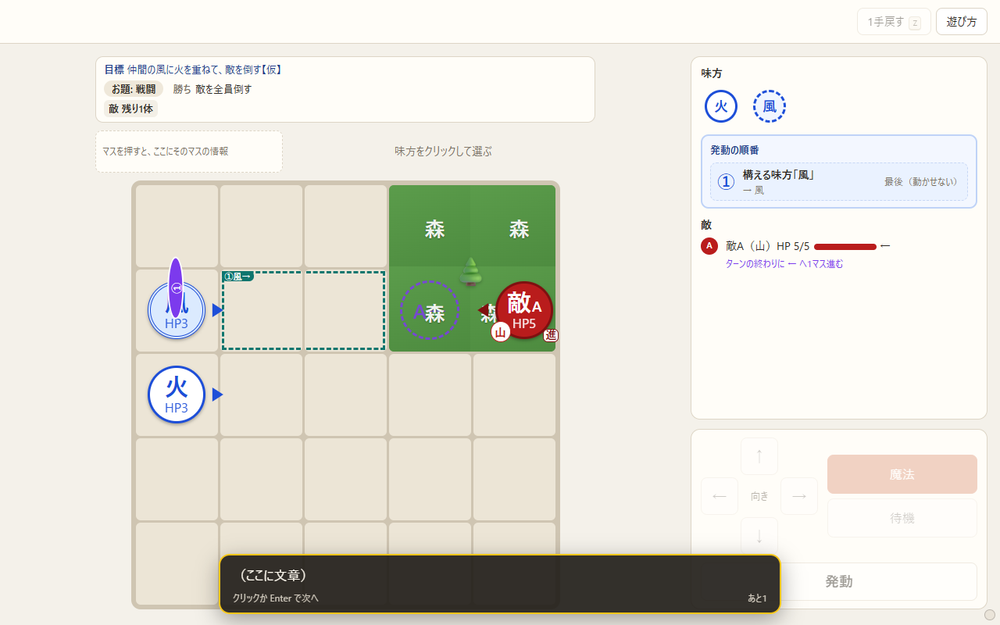 |
| ① 敵のマスを押した（左上に絵＋名前） | 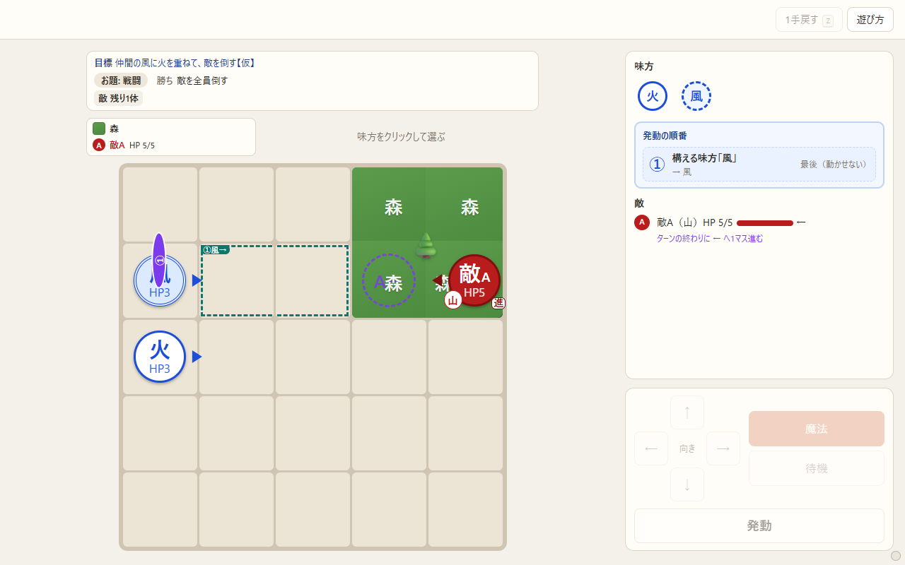 |
| ① 味方を選んで動かし、上を向けた | 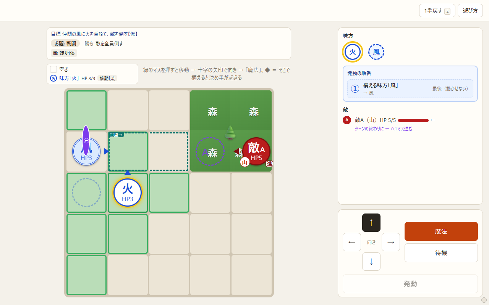 |
| ① 構えた（アイコンが薄く、発動が光る） | 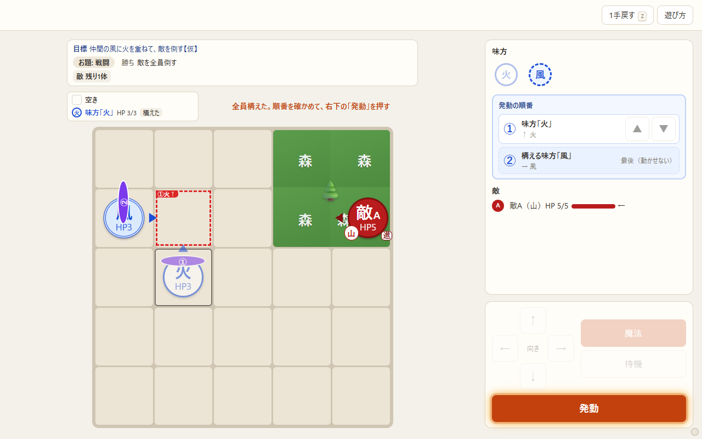 |
| ① クリア（右下が「次へ」） | 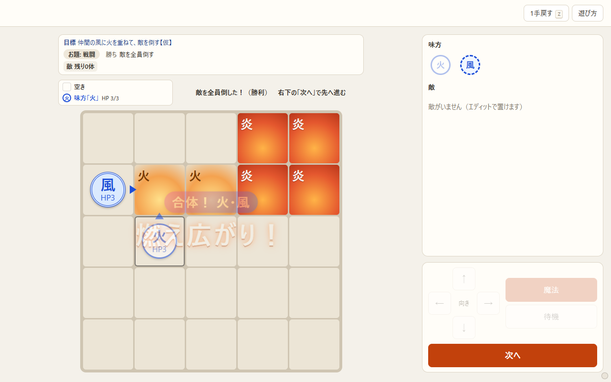 |
| ② 始め | 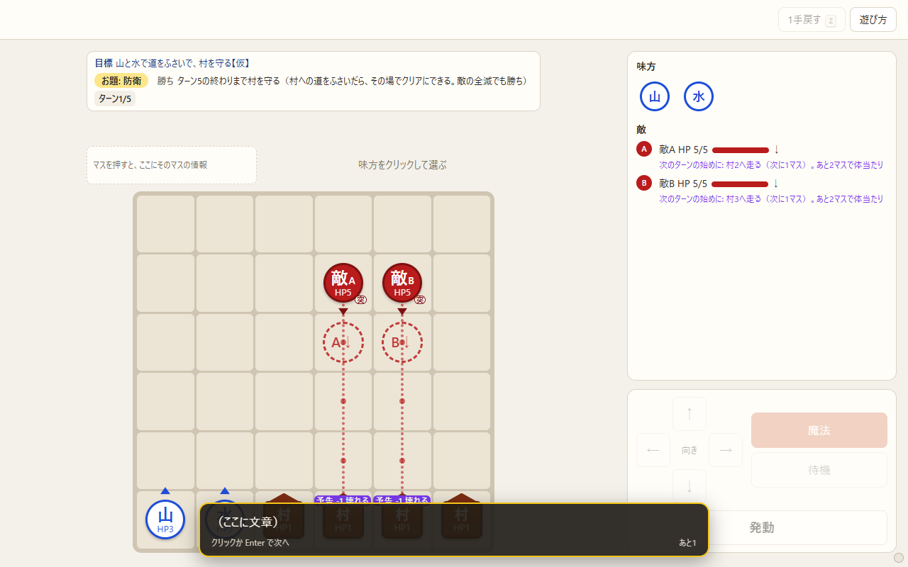 |
| ② 負け（右下が「やり直す」） | 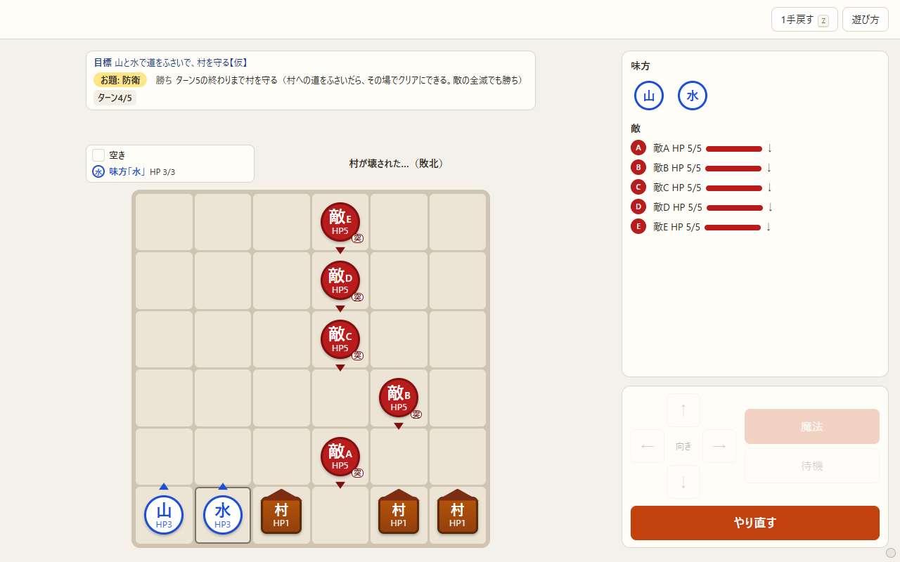 |
| ② やり直した（ヒントの1行） | 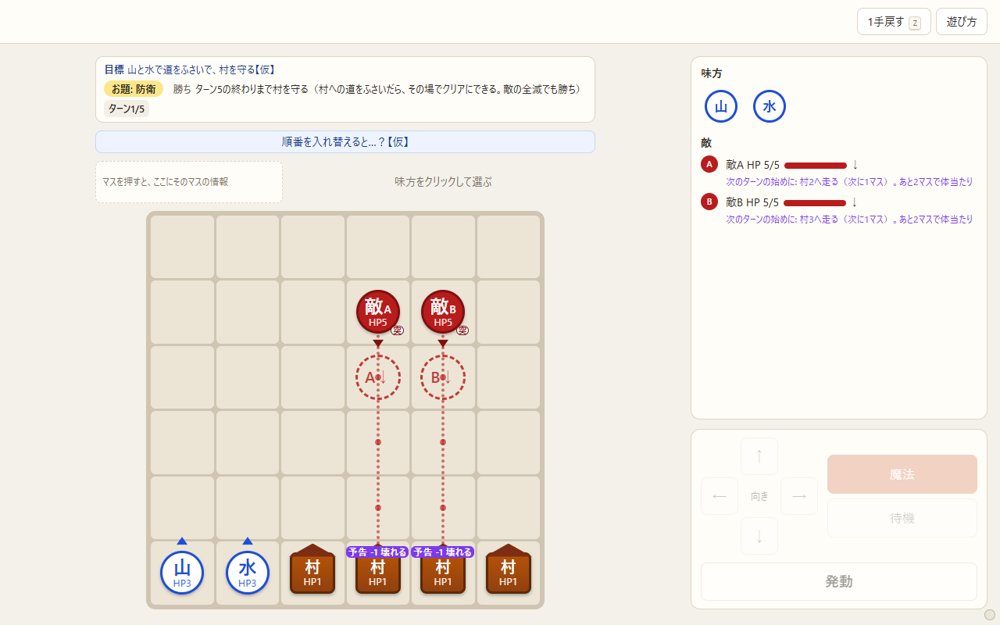 |
| ② 道をふさいだ（右下が「クリアする」） | 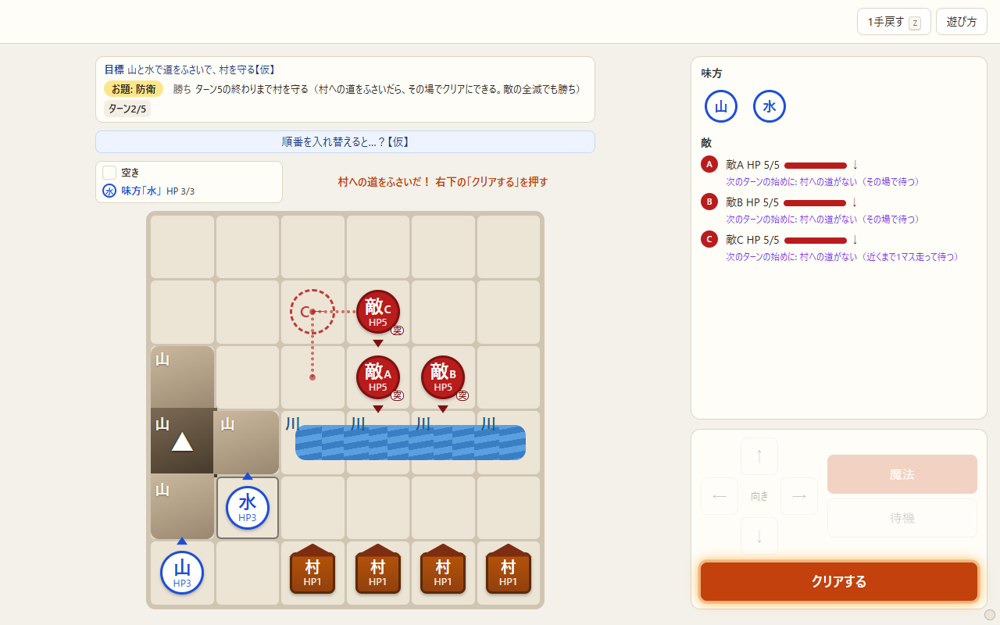 |
| ③ 始め | 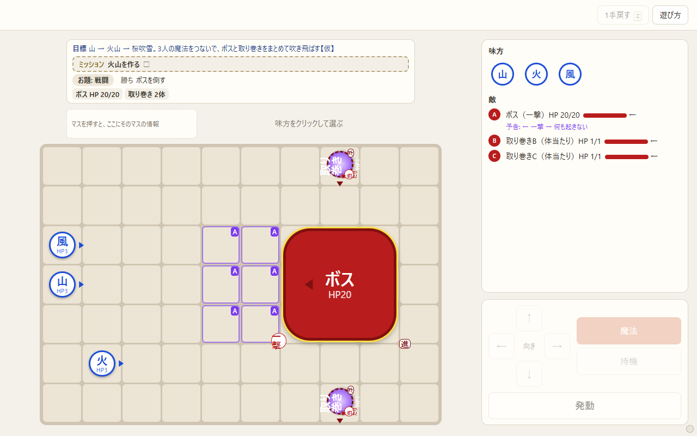 |
| ③ 3人が構えた | 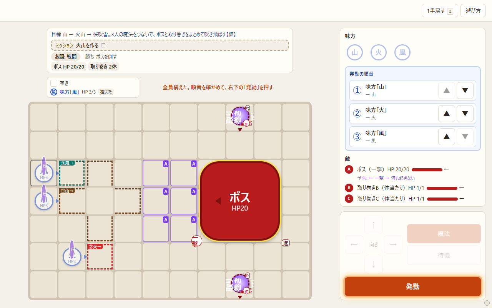 |

---

## ここがこうなった

### 段1 盤面のクリックとキー

| 前 | 今 |
|---|---|
| 誰も選んでいないときに盤面を押すと、発動・②のクリア・次へ に進んだ | 進まない。押したマスが左上に出るだけ |
| 演出の途中で盤面を押すと飛ばせた | 飛ばさない。押したマスが左上に出るだけ（キーを押すと飛ばせるのは残した） |
| 構えた味方を押すと、構え直せた | 薄い味方（構えた・待機した）は押しても選ばない。「もう行動しました」も出さない |
| 矢印キーで向きが変わった（展示も） | 展示では効かない。開発モードだけ |
| 「処理中…（盤面のクリックかキーで飛ばせます）」 | 「処理中…」 |

### 段2 右下のボタンと右の欄の分け方

| とき | 右下のボタン |
|---|---|
| まだ構えていない味方がいる | 発動（押せない） |
| 全員が構えた・待機した | 発動（光る） |
| ②で村への道をふさいだ | クリアする（光る） |
| 展示でクリアした | 次へ（会話の窓を閉じて 0.4 秒あけてから押せる） |
| 負けた | やり直す |

- 上のバーの「発動」、盤面の上の「クリアする」「やり直す」はなくした。展示の上のバーは「1手戻す」「遊び方」だけ。
- 右の欄は、右上（味方・発動の順番・敵）と右下（コントローラー）の2つ。右下は **盤面の下端にそろう**。右上が長くなっても右下は動かず、右上だけスクロールする。
- 誰も選んでいないときの Enter は、右下のボタンを押したのと同じ。
- 幅 980px 以下（盤面の下に右の欄が回るとき）は、今までどおり上から並ぶ。

### 段3 コントローラーと味方のアイコン

- 十字の真ん中は「向き」。
- 「味方「山」　その場　向き ↑」の行と「移動を取り消す」ボタンはなくした。戻したいときは、元のマスを押す・1手戻す・Esc。
- 撃てないときは、魔法ボタンの文字が「宝を持つので撃てない」になる（展示では出ない）。
- 十字のボタンと魔法・待機を少し大きくした。
- 味方はアイコンだけ（丸に魔法の字）。押すと、盤面のその味方を押したのと同じ。
  - 選んでいる味方は黄色く光る／構えた・待機した味方は薄い（選べない）／移動しただけは薄くしない／構える味方は点線の丸。

### 段4 盤面の上（盤面がずれない）

- 目標の帯: 防衛の村の行をなくし、ターンはいつも「ターン4/5」の形。状態とミッションの行は折り返さない。
- 押したマスの情報: いつも2行。1行目は地形の絵・名前・印、2行目は駒の絵・名前・HP・ようす。座標・魔法・向きは出さない。
- 案内の1行: 高さを決めた（2行まで）。勝ち負けの文も同じ字の大きさ。
- やり直したあとのヒント: ヒントのあるステージ（②など）では、出ていないときも場所をとっておく。
- 盤面の大きさ: 上の段の下から画面の下までに収まるように、ステージが変わったときと画面の大きさを変えたときだけ決め直す。

**測った（1024×768）**: 盤面の上端の位置

| ステージ | 通した場面 | 上端 |
|---|---|---|
| ① | 始め → 選ぶ → 動く → 向き → 構える → マスを押す → 発動 → クリア → 次へが押せる | ずっと 230.5px |
| ② | 始め → 待機と発動を3ターン → 負け → やり直す（ヒントが出る） | ずっと 293px |
| ③ | 始め → ミッション達成の表示 → 3人が構える | ずっと 264px |

前は、①でクリアしただけで盤面が 19px 下にずれていた。

### 段5 文

- 遊び方は、オーナーの7行に置きかえた（題は「あそびかた」。「見出し：」の所を太く）。
  - 「やめたいときは「取り消し」」→「やめたいときは、元のマスをクリック」
  - 「左下のボタン」→「右下」
  - 「発動のあとも」は外した
- 案内の文:
  - 全員構えた →「全員構えた。順番を確かめて、右下の「発動」を押す」
  - ②でふさいだ →「村への道をふさいだ！ 右下の「クリアする」を押す」
  - クリアした →「（クリアの文）　右下の「次へ」で先へ進む」
  - 味方を選ぶ →「味方をクリックして選ぶ」（「1〜3 キー」を外した）
  - 選んだ →「緑のマスを押すと移動 → 十字の矢印で向き → 「魔法」。◆ ＝ …」（「（Enter）」を外した）
  - チュートリアル①②の始めの【仮】の文 →「…右下の「発動」を押そう【仮】」
- 使わなくなった文（構え直しの案内・味方を選ぶ前の案内）は外した。

---

## 【仮】で決めたこと（確かめてほしい）

1. **予告でダメージを受ける味方の印**: アイコンの右上に紫の「-3」、倒れるなら赤い「!」。くわしくはマウスを重ねると出る。
2. **構える味方（選べない味方）**: 点線の丸のアイコン。押すとマスの情報が出るだけ。構えの中身は「発動の順番」に出る。
3. **マスの情報**に、駒の魔法と向きは出さない。敵は丸に A・B、村・馬車は四角に「村」「馬」。
4. **決着のあと**は、マスの情報に味方のようす（構えた・待機）を出さない（発動した味方が「待機」に見えたため）。
5. ほかのお題（全滅・護衛・奪取・ボス）の状態の行は中身はそのまま。折り返さないようにだけした。
6. 魔法・待機のボタンから `Enter` `W` の表示を外した（前から隠れていた）。**「1手戻す」の `Z` は残っている。** 展示で消すかどうか。
7. 開発モードでクリアしたときの右下のボタン: 「発動」のまま押せない。
8. 案内の言い方「右下の「〇〇」を押す」。

---

## 気づいたこと・残っていること

- **1024×768 の画面で③の3人が構えると、右上が約 100px はみ出す。** 右上だけスクロールして、敵の欄が下に隠れる。1280×800・1920×1080 では収まる。発動の順番の ▲▼（44px）を小さくすれば収まる。
- 会話の窓（画面の下）が、右下のボタンに少し重なる（幅 1280）。窓が出ている間はボタンを押せない時なので、困ることはない。
- 内蔵ブラウザが隠れていて写真が撮れなかったので、写真はヘッドレスの Edge で撮った。動きは内蔵ブラウザで確かめた。

---

## 確かめたこと

- 展示: ①を通しでクリア → 右下の「次へ」→ ② → 負け → やり直す → 道をふさいで「クリアする」→ 次へ → ③。
- 盤面の何もないマス・薄い味方・構える味方を押しても、進まない・選ばない。
- アイコンを押すと選べる。十字のボタンで向きが変わり、選ばれた見た目になる。
- 展示で矢印キーが効かない／Enter で魔法／Z で1手戻す。開発で矢印キーが効く。
- 開発モード: 最初の画面 → 遊ぶ → E でエディット（右の欄は今までどおり）→ E でテストプレイ（右上・右下に分かれる）。
- 予告ダメージの印（③で味方を敵の予告のマスに置いたとき「!」）。
- 幅 900px で右の欄が盤面の下に回る。

## テスト

`node tests/run.js`・`scenarios.js`・`simul.js`・`ex3.js`・`stages.js`・`stage_api.js` の出力が、作る前と同じ（run 246 成功 / 47 失敗、scenarios 39 失敗、ex3 6 / 8、stages 113 OK、stage_api 5 / 0。失敗は前からのもの）。すべての .js に `node --check`。

## 変えたファイル

| ファイル | 中身 |
|---|---|
| `index.html` | 上のバーの発動・盤面の上の2つのボタンを外す。右の欄を右上（`playPanel`）・右下（`ctrlPanel`）に分け、右下のボタン（`btnGo`）。`actInfo` を外す |
| `ui.js` | 盤面のクリック、選ぶ、右下のボタン（`goState`・`goPress`）、味方のアイコン、コントローラー、マスの情報、ヒントの場所、盤面の大きさ（`fitBoard`）、キー、遊び方 |
| `style.css` | 右の欄の分け方、右下のボタン、アイコン、コントローラー、盤面の上の段の高さ、マスの情報の絵 |
| `rules.js` | `missionInfo` の防衛の状態（村の行をなくし、「ターン4/5」の形） |
| `texts.js` | 遊び方の7行と案内の文 |
| `DECISIONS.md` | 「操作と画面の配置」を追記 |
| `.claude/IMPROVE_controls.md` | 作ったことを1行 |
