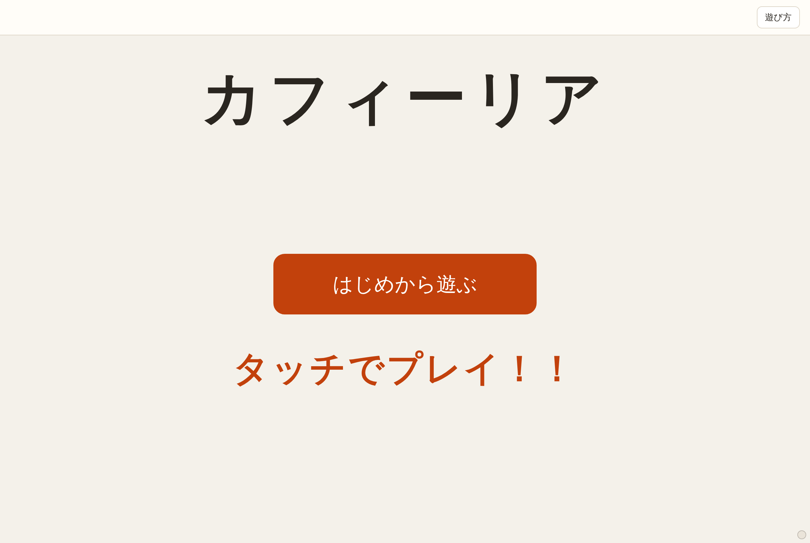
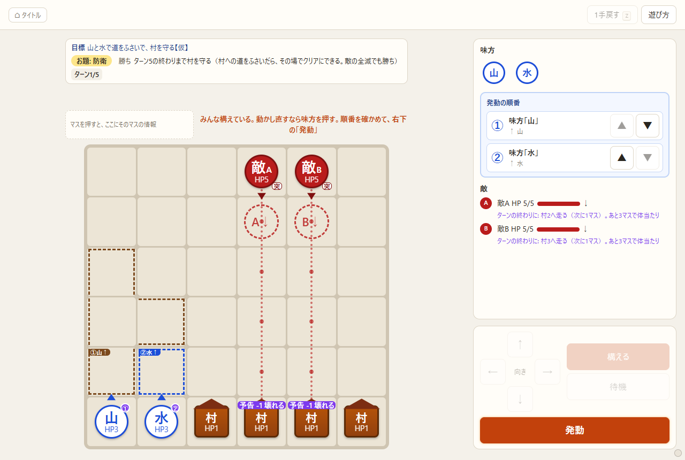
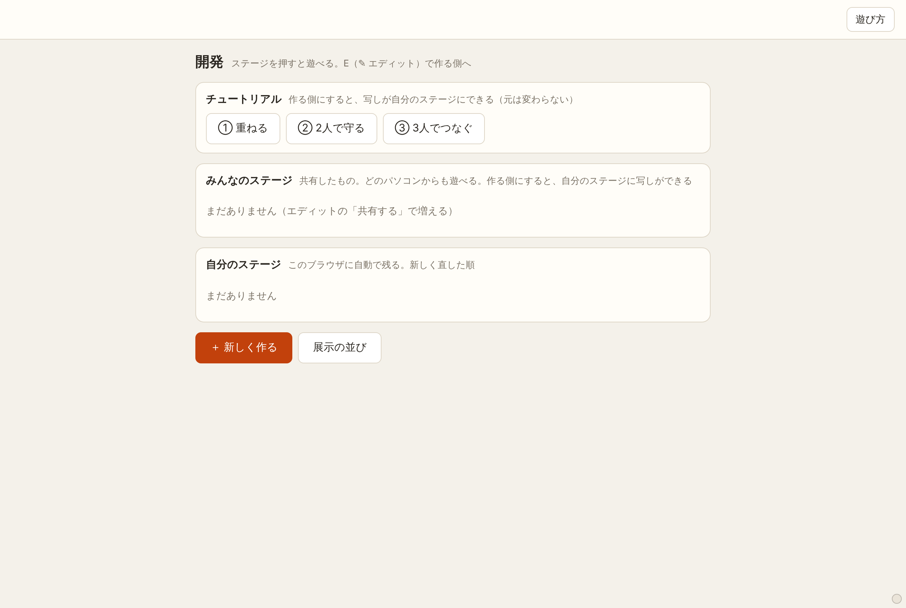
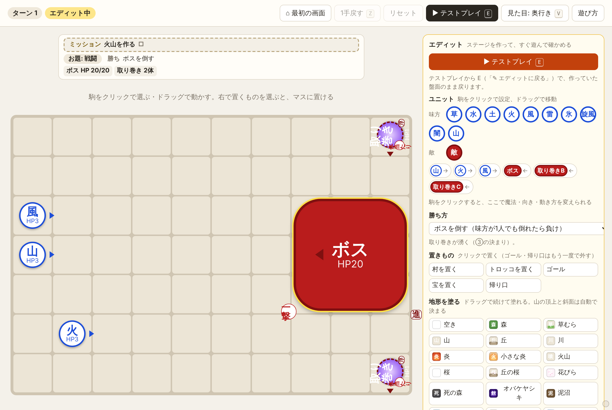

# 画面構成

画面のどこに何があるか。遊び方そのものは [遊び方](遊び方.md)。

（11/03 時点の画面から書いた。図は 1280×860 の画面）

## 2つのモード

| モード | 開き方 | 何のため |
|---|---|---|
| 展示モード | `index.html` をそのまま開く | 試遊の人が遊ぶ。遊ぶのに要るものだけを出す |
| 開発モード | URL の後ろに `#dev`（例: `index.html#dev`） | 作る人が使う。ステージを作ってすぐ試す（エディット）・共有・展示の並び |

- 決まり（ルール・数）はどちらも同じ。
- 開発モードから展示モードへは、右下の小さな点を2秒長押し（そのタブの中だけ。読み込み直しても続く）。
- 開発モードでブラウザ（スマホ）の「戻る」を押すと、開発モードのまま1つ上の画面へ戻る（テストプレイ → エディット → 開発の最初の画面。最初の画面ではその場に残る。開いている窓があれば先に閉じる）。展示モードには戻らない。
- モードは `game/mode.js` が最初に決める。展示で隠すものは `game/style.css` の `html.mode-exhibit`。

## 展示モード

### 最初の画面



- 題字「カフィーリア」・「はじめから遊ぶ」・「タッチでプレイ！！」。
- 「ステージを選んで遊ぶ」は、開発モードの「展示の並び」で出すステージを決めたときだけ出る。
- 右上の「遊び方」で、あそびかたの窓（6行）。初めて開いたときは最初に出る。
- 遊び終えると「ありがとう！」（はじめから遊んだとき）か「クリア！」（選んで遊んだとき）。どちらにも試遊アンケートの QR（`game/survey_qr.png`）と [最初の画面に戻る]・[ほかのステージで遊ぶ]。

### 遊ぶ画面



```
┌ 上のバー ─────────────────────────────── ┐
│ [⌂ タイトル]                     [1手戻す Z][遊び方] │
├────────────────────────┬──────────────┤
│ 目標の帯                               │ 右上：見るところ        │
│  目標・お題・勝ち・ターン・ミッション  │  味方（アイコン）       │
│ 押したマスの情報 │ 案内の1行           │  発動の順番（▲▼）      │
│ やり直したあとのヒントの1行            │  敵（HP・予告）         │
│ ┌ 盤面 ──────────────┐   ├──────────────┤
│ │                                │   │ 右下：さわるところ      │
│ │                                │   │     ↑                  │
│ │                                │   │  ← 向き →  [ 魔法 ]    │
│ └────────────────┘   │     ↓      [ 待機 ]    │
│                                        │ [ 発動／次へ など ]     │
└────────────────────────┴──────────────┘
```

**盤面の上**（中身が変わっても高さは変わらない。盤面がずれないように）

- 目標の帯: 目標の文・お題・勝ち方・敵の残り・ターン（「ターン 4/5」）・③のミッション（「火山を作る □ → ✔」）。
- 押したマスの情報（左上）: 押したマスの自然の絵と名前・印（通れない・入ると止まる など）、駒がいれば名前・HP・ようす（構えた・待機・移動した・泥沼で休み・火傷 など）。いつも2行。
- 案内の1行: 次にすること・勝ち負けの文。
- やり直したあとのヒントの1行: 負けてやり直したときだけ出る（文は `game/texts.js` の `stages.<ステージ>.hint`）。

**盤面**

- 駒: 味方は青い丸（魔法の字と HP）、敵は赤い丸（ボスは大きな四角）。向きは駒の横の三角。
- 緑のマス: 選んだ味方が動ける所。
- 点線: 今の向きで構えたときに魔法が届く形（何が起きるかは出ない）。形どうしが重なったら、後の形を少し内側にずらして入れ子で描く（どれも隠れない）。同じマスの札は縦に並ぶ。
- 紫の印: 敵の予告（次に撃つ所。印の字はどの敵か）。
- 構えた魔法は、盤面に番号つきの札で出る（①風→ など）。
- 自然はマスの色と字（森・山・炎・川 など）。つながった森や水は1枚の大きな絵になる。

**右上：見るところ**

- 味方: アイコンだけ。押すと盤面でその味方を押したのと同じ。選んでいる味方は光り、待機の味方は薄くなる（いつでも選べる）。
- 発動の順番: ▲▼ で入れ替える（展示モードでも出す。オーナー 11/03）。待機の味方は下に薄く出て、順番から外れる。
- 敵: 名前・HP・動き方・予告の中身。

**右下：さわるところ**

- 十字の矢印で向き（押すとすぐ変わる。盤面の点線もその向きに変わる）。「待機」で撃たない、「構える」で待機から戻す。今の状態のボタンに ✓。誰も選んでいないときは押せない。
- 右下のボタンは1つで、場面で字が変わる。

| とき | ボタン |
|---|---|
| ふだん（味方は最初から構えている） | 発動（いつでも押せる） |
| ②で村への道をふさいだ | クリアする |
| クリアした | 次へ |
| 負けた | やり直す（③は自動でやり直す） |
| 発動の演出の途中 | 押せない |

## 開発モード

### 最初の画面



- **一覧は1行に1つ**（オーナー 11/03）: 難易度の札・タイトル・使う魔法・クリア方法・消す。列の幅は決まっていて、どの行・どの欄でも縦がそろう（狭い画面では2段: 1段目 難易度・タイトル・消す、2段目 クリア方法・使う魔法）。
  - 難易度: チュートリアル／やさしい／ふつう／むずかしい（エディットの「ステージ」の欄で選ぶ。決めていないものは札なし）。
  - 使う魔法: 味方の魔法から自動で出る。構える味方（指示できない仲間）の魔法は「（仲間）」。
  - クリア方法: 勝ち方から自動で出る短い名前（戦闘・ボス・防衛・護衛・奪取。破壊は勝ち方ができたら足す）。
  - タイトル: 名前に区分の印（【チュートリアル】など）が付いていれば、一覧では外す（札に任せる）。
- **難易度・クリア方法で分ける**: 一番上の2段の札（難易度: すべて・チュートリアル・やさしい・ふつう・むずかしい／クリア方法: すべて・戦闘・ボス・防衛・護衛・奪取）を押すと、それだけになる（両方で絞れる）。選んだ札は覚える。どの欄も難易度の順（札なしは最後）に並ぶ。
- **チュートリアル**: ①②③（難易度はチュートリアル）。押すと遊べる。作る側（エディット）にすると、写しが自分のステージになる（元は変わらない）。
- **みんなのステージ**: エディットの「共有する」で置いたもの。どのパソコンからも遊べる（Cloudflare に置く）。
- **自分のステージ**: このブラウザに自動で残る。新しく直した順。
- **消す → ゴミ箱**（オーナー 11/03）: 「消す」はゴミ箱へ移す（確かめの窓は出ず、上に「ゴミ箱に入れた [戻す]」が少し出る）。一番下の「ゴミ箱（n）」を開くと、消したステージ（自分／みんな）と消した日時が並び、[戻す]・[完全に消す]（確かめてから。元に戻せない）。戻すとき同じ名前があれば「名前（2）」。展示の並びに入っているみんなのステージは消せない。
  - 共有の置き場所がゴミ箱のない古い版（まだ公開していない）のときは、みんなのステージの「消す」は今までどおり、確かめてから完全に消す。
- **＋ 新しく作る**: 空の盤面でエディットを開く。
- **ファイルから読む**（オーナー 11/10）: ステージのファイル（.json）を選ぶと、そのブラウザの自分のステージに入る（ネットには出ない）。1つのファイルに、ステージを1つでも、まとめていくつでも入れられる。同じ名前があれば「名前（2）」にする（上書きしない）。読めないものは飛ばして、上に理由を出す。みんなのステージへは、入れたあとエディットの「共有する」で。
  - まとめたファイルの例: `stages/草からはじめる.json`（20ステージの案のうち、今のルールで作れる12。`node tools/stages20.js` で書き出す）。
- **展示の並び**: 展示モードの「はじめから遊ぶ」の順番と、「選んで遊ぶ」に出すステージを決める（ドラッグで並び替え）。
- **プレイ集**: クリアした攻略の記録を流す（下の「プレイ集」）。
- **ステージの背番号**（オーナー 11/10）: どのステージ（チュートリアル・みんなのステージ・自分のステージ）にも、画面には見えない背番号がある。プレイ集の記録は、名前ではなく背番号でステージを指す。
  - 名前を変える・ゴミ箱から戻す（「名前（2）」になっても）・同じ名前で上書きして共有する、では背番号はそのまま（記録もついてくる）。
  - 写す（「〜のコピー」・みんなのステージを自分のステージに写す・ファイルから読む）と新しい背番号になる（記録は元のステージに残る）。
  - 背番号のない今までのステージには、最初に読んだときに付く。
- **ステージごとに変えられる数値**（オーナー 11/12）: 守るターン数と、敵の歩数（突進の敵が1ターンに進むマス数）だけ。魔法の形・シナジーの長さなど、魔法の効き方はどのステージでも同じ。ほかの数値を書いたステージのファイルは、読むときに断る（`game/stages_io.js` の `STAGE_OVERRIDES`）。

### 設定（オーナー 11/03）

開発の最初の画面の「設定」（「展示の並び」の隣）。画面の主な色と、名前を変える。中身は `game/settings.js`。

- **色**（12）: 背景・パネル・枠線・文字・うすい文字・大事なボタン・ボタンの地・盤面の枠・味方・敵・敵の予告・光る印。RGB（0〜255 の3つの数）か、色の四角を押して選ぶ。1つずつ「元に戻す」。自然一つ一つの色（森・山…）は入れていない。
- **名前**（空なら元の名前）:
  - 自然: 表示名（押したマスの情報・エディットの塗る道具・ログの文 など）と、マップに出る字（3文字まで）
  - 魔法: 名前（駒の字・ログの文 など）
  - シナジー: 名前（真ん中に出る文字・ログの文）。元の名前は「自然×魔法」の形（火×風・山×火×風 など。順番あり。途中でできた自然は元の組み合わせまでほどく。オーナー 11/04）
  - 画面に出す名前だけが変わる。ルールが見分けに使う名前は変わらない。チュートリアルの目標やヒントの文（`game/texts.js` のステージの文）は変わらない。
- 変えるとすぐ、そのページの色と名前が変わって見える（まだ保存していない）。「この設定で保存する」で共有の置き場所に置くと、どのパソコンの展示モード・開発モードも、この設定で出る（⚠ の注意つき）。「やめて一覧に戻る」で保存した設定に戻る。「ぜんぶ元に戻す」は元の色と名前にする（保存するまでは下書き）。
- このブラウザにも写しを覚えておき、開いたらすぐその色で出す。つながらないときは写しか、元の色と名前。
- 共有の置き場所がまだ古い（設定を置けない版の）ときは保存できない（画面にそう出る）。公開すると使える。`node tests/serve.js` で開けば手元で試せる。

### プレイ集（オーナー 11/10）

実際のステージを攻略する様子を続けて流す。「見ているだけで楽しいか」の確かめと、映像として録画するためのもの。開発モードだけ（展示モードには何も出ない）。

**記録を取る**

- 遊んでいる間は、いつも手（移動・構える・待機・発動の順番の入れ替え・発動・②の「クリアする」）を書き留めている。「1手戻す」をすると、その手は消える。
- クリアすると、上のバーに「★ この攻略を保存する」が出る。押すと名前を付けて保存する（名前はあとで変えられる）。
- 保存するとき、迷った手（動き直し・構え直し）は最後の形だけにまとめる。まとめると結果が変わるターンは、手をそのまま残す。
- 1つのステージに、記録をいくつでも持てる。記録はステージの中身を写さず、背番号で指す。

**一覧**（開発の最初の画面の「プレイ集」）

- ステージごとに記録が並ぶ。記録ごとに「▶（この記録だけ流す）」「名前」「消す」。
- 開いたときに、どの記録もルールで最後まで計算して確かめる。クリアにならない記録（ルールやステージを変えてずれたもの）には ⚠ と理由が出て、まとめて流すときは外れる（その記録だけ ▶ で流すと、どこでずれるかを見られる）。
- 上の札で、順番（順番どおり／ランダム）・最後まで流したら（止まる／頭に戻ってループ）・速さ（×0.5・×1・×2・×4）を選ぶ。
- チェックを付けたステージ・記録だけを流す。何も付けていなければ全部。「▶ このステージ」でそのステージの記録だけ。
- ランダムは、ステージを混ぜて1周（どのステージも1回ずつ）流し、終わったらまた混ぜる。周のつなぎ目でも同じステージは続かない。同じステージに記録がいくつもあれば、その中でも順に回る。
- どれを流すか・順番・ループ・速さは、このブラウザが覚えている。

**流している画面（映像用）**

- 上のバーなど開発のボタンは隠れ、展示の遊ぶ画面と同じ見た目になる。
- ステージが替わるたびに、ステージ名（と記録の名前）を短く出してから始まる。
- 人が押すのと同じ順（選ぶ → 移動 → 向き → 構える → 発動）で進む。結果は毎回ルールで計算し直し、演出は遊ぶ画面のまま。変えているのは待ち時間だけ（`game/balance.js` の `plays`）。
  - 移動と構えは短く、シナジー・超常現象が起きた所は長く間を取る。
  - 構えた瞬間に形が光り、発動まで輪郭が少し濃く残る。
  - 決め手になる発動の直前に、撃つ人と形が光って一拍置く（ため）。
- マウスを動かすと下に「■ 止める」（と速さの札・今流している記録の名前）が出て、数秒で消える。動かしていない間は、マウスの矢印も消える。
- 止めるのは「■ 止める」か Esc だけ（盤面を押しても止まらない）。止めるとプレイ集の一覧に戻る。

### 遊ぶ画面（テストプレイ）

展示モードと同じ配置に、上のバーのボタンが増える。クリアしたときだけ「★ この攻略を保存する」も出る（上の「プレイ集」）。

| ボタン | 働き |
|---|---|
| ⌂ 最初の画面 | 開発の最初の画面へ |
| 1手戻す（Z） | ひとつ前へ |
| リセット | そのステージの頭から |
| エディット（E） | 今の盤面のまま作る側へ |
| 見た目（V） | 真上 ⇄ 奥行き（下の「見た目」） |
| 遊び方 | あそびかたの窓 |

### エディット



右の欄で盤面を作り、「▶ テストプレイ」（E）ですぐ遊んで確かめる。テストプレイから E で、作っていた盤面のまま戻る。

| 欄 | できること |
|---|---|
| ユニット | 味方（魔法を選んで置く）・敵を置く。置いた駒を押すと、魔法・向き・動き方（狙い・避ける・越える・動き）を変えられる。ドラッグで動かす |
| 勝ち方 | 敵を全員倒す・ボスを倒す・村を守る（決めたターンまで守るか、道をふさいだらクリア）・トロッコをゴールへ・宝を持って帰り口へ（`game/stages_io.js` の `WINS`）。前の「道をふさぐ」のステージは、読むと村を守るになる |
| 置きもの | 村・トロッコ・ゴール・宝・帰り口 |
| 地形を塗る | 自然を塗る（ドラッグで続けて）。山の頂上と斜面は自動で決まる |
| 盤面 | 横 × 縦の大きさ・地形を全部空きに・確認用に敵を動かさない |
| ステージ | 名前（直すたびに自動で残る）・難易度・共有する |
| やり直しのヒント | やり直したときに盤面の上に出す1行（一斉・1人ずつ） |

### 見た目（真上・奥行き）

- 真上: 盤面を真上から見る。展示モードは今これ。エディットはいつも真上。
- 奥行き: 盤を傾けて遠近をつけ、山を山肌で描き、駒を立てる（HD-2D の方針。`.claude/HD-2D_方針_20261031.md`。段4の光とぼかしはまだ）。
- 開発モードは上のバーの「見た目」か V キーで切り替え、選んだ方を覚える。展示モードの見た目は `game/mode.js` の `EXHIBIT_VIEW` で決める。
- 駒の絵は `game/img/` に決まった名前で入れると使われる（`game/img/名前の一覧.txt`）。ない駒は今の丸い駒を立てる。

## 保存と共有

| もの | 置き場所 |
|---|---|
| 自分のステージ・自分のゴミ箱・見た目の選び・一覧の札・設定の写し・自分のステージのプレイ集の記録・プレイ集の流し方 | このブラウザ（localStorage） |
| みんなのステージ・みんなのゴミ箱・展示の並び・設定（色と名前）・チュートリアルとみんなのステージのプレイ集の記録 | Cloudflare の置き場所（`tools/stage_worker.mjs`）。`node tests/serve.js` で開いたときは、同じものが手元で動く |
| 画面の文（目標・ヒント・クリアの文など） | `game/texts.js` |

共有の置き場所につながらないとき（ネットがない・ファイルを直接開いた など）は、展示はチュートリアル①②③だけになる。

## 画面を作っているファイル

| ファイル | 中身 |
|---|---|
| `index.html` | 画面の骨組み（上のバー・盤面・右の欄・窓） |
| `game/ui.js` | 画面の動き（描く・押す・キー・演出・エディット・展示の流れ） |
| `game/style.css` | 見た目（展示で隠すもの・奥行きの傾きも） |
| `game/mode.js` | 展示 ⇄ 開発・見た目の切り替え |
| `game/texts.js` | 画面に出る文 |
| `game/stages_io.js` | エディットのステージの読み書き |
| `game/plays.js` | プレイ集の記録（形・まとめ方・確かめ・流す順番）と、ステージの背番号 |
